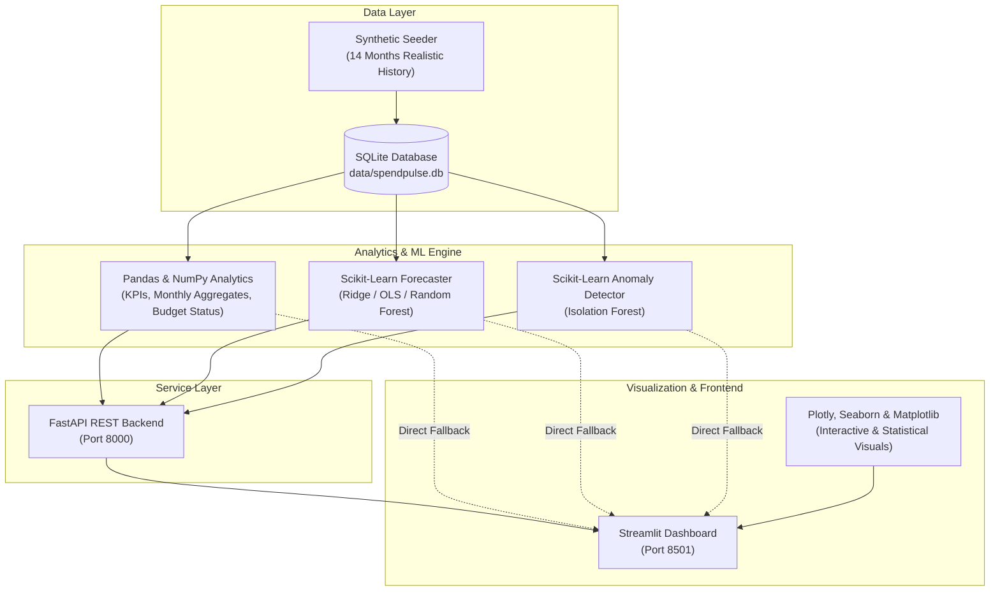

# 🇮🇳 SpendPulse India | Smart Khata & AI Personal Finance Analytics

> **Data Science / Machine Learning Portfolio Project**  
> An end-to-end personal finance intelligence platform tailored for the **Indian market**. Features standard INR (`₹`) Lakhs & Crores formatting, UPI & quick-commerce insights, Exploratory Data Analysis (EDA), Time-Series Expense Forecasting, Isolation Forest Anomaly Detection, a FastAPI REST service, and an interactive Streamlit dashboard.

---

## 🌟 Highlights & Capabilities

- **🗄️ Robust Data Persistence (SQLite)**:
  - Tracks income, categorized expenses, and monthly budget allocations with ACID compliance.
  - Built-in synthetic financial data generator seeding 14+ months of realistic transactions with seasonality and deliberate anomalies.
- **📊 Exploratory Data Analysis (EDA) & Financial Analytics**:
  - Key financial KPIs: Net Savings, Savings Rate (%), Average Daily Burn, Budget Utilization.
  - Interactive **Plotly** visualizations: Cash flow bar/line charts, category donut breakdowns, and budget progress gauges.
  - Deep-dive statistical charts with **Matplotlib** and **Seaborn**: Correlation heatmaps, category-wise outlier boxplots, and probability density (KDE) distributions.
- **🤖 Machine Learning Models (Scikit-Learn)**:
  1. **Time-Series Expense Forecasting**:
     - Engineered lagged features ($t-1$, $t-2$), 2-month rolling moving averages, month seasonality, and linear time trends.
     - Algorithms: **Ridge Regression (L2)**, **Linear Regression (OLS)**, and **Random Forest Regressor**.
     - Full evaluation metrics: **MAE**, **RMSE**, and **$R^2$ Score** alongside $90\%$ confidence interval envelopes and category-level spending projections.
  2. **Unusual Transaction Detection (Isolation Forest)**:
     - Unsupervised anomaly detection trained on transaction magnitude, category z-scores ($\sigma$), category median ratios, and calendar attributes.
     - Intuitive $0 - 100$ Anomaly Risk Score with automated human-readable explanation reasoning (e.g., *"36.7x higher than category median | 8.9σ above average spend"*).
- **⚡ High-Performance REST Backend (FastAPI)**:
  - Clean RESTful endpoints for transactions, budgets, analytical aggregates, forecasting, and anomaly detection.
  - Interactive Swagger UI documentation at `/docs`.
- **🖥️ Polished Streamlit UI**:
  - 5-tab reactive web application with custom CSS styling and responsive layouts.
  - Graceful architecture fallback: Runs via FastAPI or directly queries SQLite if the API is offline.

---

## 🏗️ Architecture Overview



---

## 📁 Repository Structure

```
D:\Project_Ltm_2\
├── data/
│   └── spendpulse.db           # SQLite database
├── src/
│   ├── __init__.py
│   ├── database.py             # SQLite models, CRUD, and synthetic data seeder
│   ├── analytics.py            # Financial KPIs, trend aggregations, and budget calculations
│   ├── visualizations.py       # Plotly interactive charts & Seaborn/Matplotlib figures
│   ├── api.py                  # FastAPI REST endpoints and Pydantic schemas
│   └── ml/
│       ├── __init__.py
│       ├── forecaster.py       # Scikit-learn monthly expense forecasting engine
│       └── anomaly_detector.py # Scikit-learn IsolationForest outlier detection engine
├── tests/
│   └── test_spendpulse.py      # Automated pytest unit test suite (100% pass)
├── app.py                      # Streamlit interactive web application
├── run_app.py                  # One-click launcher (starts both FastAPI & Streamlit)
├── seed_data.py                # Standalone CLI data generator utility
├── requirements.txt            # Python dependencies
└── README.md                   # Project documentation
```

---

## 🚀 Quick Start Guide

### 1. Prerequisites & Environment Setup

Ensure you have Python 3.10+ installed.

```bash
# Navigate to the project directory
cd D:\Project_Ltm_2

# Create virtual environment (if not already created)
python -m venv .venv

# Activate virtual environment
# On Windows PowerShell:
.\.venv\Scripts\Activate.ps1
# On Linux/macOS:
source .venv/bin/activate

# Install dependencies
pip install -r requirements.txt
```

### 2. Run with One-Click Launcher (Recommended)

Starts both the **FastAPI backend** and **Streamlit dashboard** in a single command:

```bash
python run_app.py
```

- **Frontend Dashboard**: [http://localhost:8501](http://localhost:8501)
- **FastAPI Backend**: [http://127.0.0.1:8000](http://127.0.0.1:8000)
- **Interactive Swagger Docs**: [http://127.0.0.1:8000/docs](http://127.0.0.1:8000/docs)

### 3. Run Services Separately (Optional)

If you prefer to run services in separate terminal windows:

**Terminal 1 (FastAPI Backend):**
```bash
python -m uvicorn src.api:app --reload --port 8000
```

**Terminal 2 (Streamlit Frontend):**
```bash
streamlit run app.py
```

---

## 🤖 Machine Learning Details

### 1. Expense Forecasting Model
- **Target**: Next month's aggregate expenditure $y_{t+1}$.
- **Features**:
  - $t-1$ and $t-2$ lagged spending values.
  - 2-month moving average $\frac{y_{t-1} + y_{t-2}}{2}$.
  - Month of year (1-12) to model seasonal variations (e.g., holiday spikes).
  - Time trend index $t$.
- **Algorithms**: Ridge Regression ($L_2$ regularization), Ordinary Least Squares, or Random Forest.
- **Uncertainty Quantification**: Calculates $90\%$ prediction intervals scaled by residual standard deviation $\sigma_e \sqrt{h}$ over forecast horizon $h$.

### 2. Transaction Anomaly Detection
- **Target**: Identification of suspicious, fraudulent, or unusual transactions.
- **Model**: `IsolationForest` (unsupervised tree ensemble).
- **Engineered Attributes**:
  - Raw amount (\$).
  - Category Z-score: $\frac{\text{amount} - \mu_{\text{category}}}{\sigma_{\text{category}}}$.
  - Category Median Ratio: $\frac{\text{amount}}{\text{median}_{\text{category}}}$.
  - Temporal features: Day of month, day of week, weekend indicator.
- **Explainability**: Each flagged anomaly is annotated with an interpretable reason explaining the statistical deviation from category norms.

---

## 📡 API Endpoints Reference

| Method | Endpoint | Description |
| :--- | :--- | :--- |
| `GET` | `/` | Service status and metadata |
| `GET` | `/api/health` | Health check endpoint |
| `GET` | `/api/transactions` | Query & filter transactions (date, category, type) |
| `POST` | `/api/transactions` | Add a new financial transaction |
| `DELETE` | `/api/transactions/{id}` | Delete a transaction by ID |
| `GET` | `/api/budgets` | Retrieve category monthly budget limits |
| `POST` | `/api/budgets` | Set or update a monthly category budget |
| `GET` | `/api/analytics/kpis` | Executive summary KPIs (Income, Expenses, Savings Rate) |
| `GET` | `/api/analytics/monthly` | Monthly income, expense, and net savings timeline |
| `GET` | `/api/analytics/categories` | Category-wise expense breakdown and shares |
| `GET` | `/api/analytics/budget-status`| Budget utilization against actuals for current month |
| `POST` | `/api/ml/forecast` | Train regression model and return $N$-month predictions |
| `POST` | `/api/ml/anomalies` | Run Isolation Forest and return flagged transactions |
| `POST` | `/api/admin/reset-seed` | Wipe and re-seed database with synthetic data |

---

## 🧪 Automated Testing

SpendPulse includes an automated test suite verifying CRUD operations, analytical calculations, ML forecaster accuracy, and REST endpoints:

```bash
pytest tests/ -v
```

All 6 test suites pass with sub-second execution times.

---

## 🛠️ Tech Stack

- **Core**: Python 3.12
- **Data Science & EDA**: Pandas, NumPy
- **Visualizations**: Plotly, Seaborn, Matplotlib
- **Machine Learning**: Scikit-Learn (Ridge, LinearRegression, RandomForestRegressor, IsolationForest)
- **Database**: SQLite
- **Backend API**: FastAPI, Uvicorn, Pydantic
- **Frontend UI**: Streamlit
- **Testing**: Pytest, HTTPX

---

## 📜 License
MIT License. Open-source for learning and data science portfolio showcasing.
